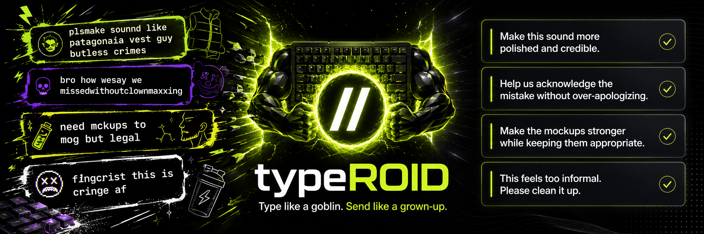

<p align="center">
  
</p>

<p align="center">
  <strong>Hold fn. It types what you said.</strong>
</p>

<p align="center">
  A walkie-talkie for the cursor, plus the two-character stack. Open source. No telemetry. No account.
</p>

---

## What is typeROID?

Hold fn, talk, release. What you said pastes at the cursor. Ums come out. The words stay yours.

Double-tap fn for hands-free. The next fn press stops and pastes. Then type two characters when you want a tool: fix, math, ask, translate, screen, summarize, or rephrase.

## Triggers

| Trigger | What it does | Example |
|---------|-------------|---------|
| `fn` | Dictate | Hold to talk, release to paste. Double-tap for hands-free |
| `//` | Fix your text | `heyy john cn u movee the mtg//` |
| `>>` | Ask with screen | `what is this error >>` sends the prompt plus a full-screen screenshot |
| `??` | Ask AI anything | `whats 3pm EST in london??` |
| `;;` | Translate | `hello how are you doing;;` |
| `==` | Math & conversions | `15% of 340==` |
| `\\` | Summarize + reply | Copy a thread, type `\\`, get a summary and draft reply inline |
| `\|\|` | Rephrase | Paste canned/corporate text, hit `\|\|`, get it rewritten like a human said it |

## Fn dictation

Hold fn and speak. Release, and what you said pastes at the cursor. Ums, uhs, and ahs come out. Sentences start with a capital, and the word I is capitalized. Nothing else is rewritten, and it does not summarize. Double-tap fn for hands-free. The next fn press stops and pastes. Escape cancels. A single short tap does not record.

Typing does not start the microphone. `..`, `,,`, and `//` leave the mic alone. `//` fixes text you already typed.

While typeROID is enabled, fn is the dictation key. Turn typeROID off in the menu when you want the globe key for emoji or input switching.

Voice audio is transcribed locally with Whisper when installed through Homebrew. While recording, typeROID temporarily lowers your Mac's output volume so local audio is less likely to leak into the transcript. It restores the original volume as soon as recording stops.

For safety, typeROID does not activate in password fields, secure text fields, or browser address bars. Use it in the page or app text field instead.

## Screen context mode

Type a prompt, then `>>`, and typeROID sends that prompt plus a full-screen screenshot to your configured model. The answer replaces your prompt inline.

Screen context mode is explicit. Screenshots are not used for `//` cleanup or fn dictation. It currently works with OpenAI, Claude, and Gemini vision-capable models. It requires macOS Screen Recording permission.

## Install

### Homebrew (recommended)

```bash
brew install --cask chadwittman/typeroid/typeroid
```

### Update

```bash
brew reinstall --cask --force chadwittman/typeroid/typeroid
```

The Homebrew cask also installs `whisper-cpp` and downloads the local Whisper model used by dictation.

### Manual

1. Download `typeROID.dmg` from [Releases](../../releases)
2. Open the DMG and drag `typeROID.app` to your Applications folder
3. Open it. Follow the onboarding.

After either method: grant Accessibility and Input Monitoring permissions when prompted, then paste your API key (OpenAI, Claude, Gemini, Groq, or run local models with Ollama).

## Build from source

```bash
git clone https://github.com/chadwittman/typeroid.git
cd typeroid
swift build -c release
bash scripts/install-dev-app.sh
```

Requires Xcode Command Line Tools and macOS 14+.

## Providers

typeROID works with any of these. Bring your own API key — or run fully local with Ollama.

| Provider | Default Model | Cost |
|----------|--------------|------|
| OpenAI | gpt-4.1-nano | ~$0.0001/message |
| Anthropic (Claude) | claude-haiku-4-5-20251001 | ~$0.001/message |
| Google (Gemini) | gemini-2.0-flash | Free tier available |
| Groq | llama-3.1-8b-instant | Free tier available |
| Ollama | any local model | Free — runs on your machine |

For Ollama: install [Ollama](https://ollama.com), pull a model (`ollama pull llama3`), then select Ollama in the typeROID menu. No API key needed. Nothing leaves your machine.

## Privacy & Security

typeROID is built for people who care about where their data goes.

- **No telemetry.** No analytics. No crash reporting. No network calls except your AI provider.
- **No database.** No account. No signup. Nothing stored on disk except your settings.
- **No logs.** Your text is never written to a file. It lives in memory during the API call, then it's gone.
- **API keys in Keychain.** Stored encrypted in macOS Keychain. Never logged or printed.
- **Sensitive data blocked.** SSNs, credit card numbers, passwords, and API keys are detected and blocked before they leave your machine.
- **Secure text fields blocked.** typeROID won't activate in password fields or browser address bars.
- **Small native core.** The app is Swift/AppKit. The Homebrew cask installs `whisper-cpp` and a tiny local model for voice transcription.
- **Fully open source.** Every line is auditable. Read [SECURITY.md](SECURITY.md) for the full breakdown.

> **Google Gemini note:** Google's API puts your API key in the URL. Your text is encrypted (HTTPS), but the key could be visible on public wifi or corporate VPNs with network inspection. OpenAI, Claude, and Groq send the key in fully encrypted headers. typeROID warns you when you select Google.

## Writing Style

Want typeROID to sound like you? Create `~/.typeroid/style.md` with examples of how you write. Enable it from the menu: Settings > Enable Writing Style.

```markdown
I keep it casual and direct. Short sentences.
I say "hey" not "hello". No corporate language.
```

## How it works

1. typeROID runs as a menu bar app (look for the `//` icon)
2. Monitors your keyboard for fn dictation and for triggers (`//`, `>>`, `??`, `;;`, `==`, `\\`, `||`)
3. Captures text via macOS Accessibility API, listens locally for fn dictation, or captures the screen for explicit `>>` requests
4. Sends text, local transcript, or explicit screen context to your AI provider with a focused system prompt
5. Replaces your text in place, or pastes fn dictation at the cursor

For `\\` summarize mode: copy a thread to your clipboard, then type `\\`. typeROID reads your clipboard as context, generates a summary and a draft reply, and drops both inline where you're typing — summary visible, reply loaded to your clipboard for ⌘V.

## Support

[@typeroid](https://twitter.com/typeroid) on X or [open an issue](../../issues).

## License

MIT
